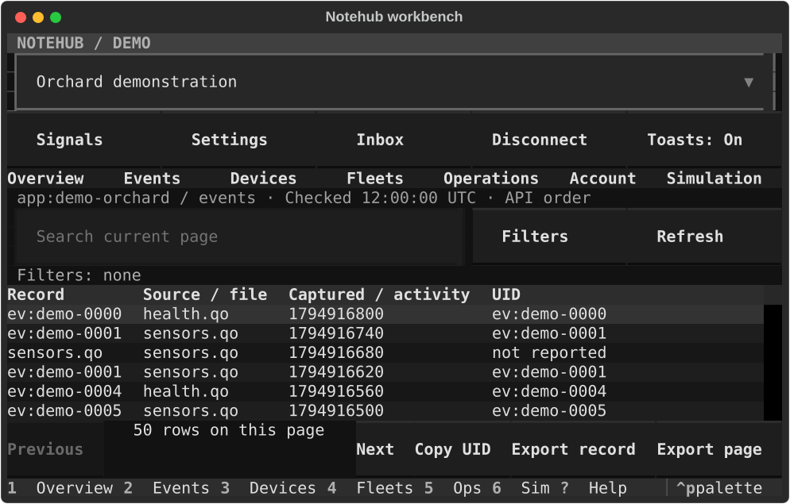
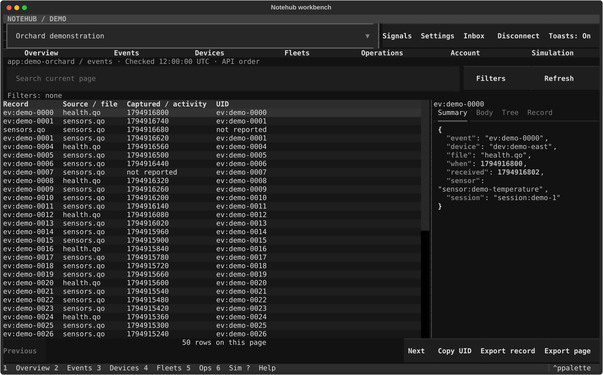

# notehub-client

### Your devices have stories to tell. Make something with them.

Turn a week's sensor readings into a report. Give a remote device its next assignment. Explore your fleet from a terminal, a browser, or your own Python app.

**An async Python client for [Blues Notehub](https://blues.com/products/notehub/), with a CLI, terminal workbench, local web dashboard, and MCP tools for your assistant.**

[**Get started →**](#get-started) · [Explore the Wiki](https://github.com/joebeeson/notehub-client/wiki) · [Ideas & issues](https://github.com/joebeeson/notehub-client/issues)

| 🐍 Build in Python | 🖥️ Explore your fleet | 🤖 Connect your assistant |
| :--- | :--- | :--- |
| Query events, work with devices, and send notes from your application. | Explore from a terminal or browser, or take the CLI into your scripts. | Give an MCP host read-only access to projects, devices, sessions, and events. |

[//]: # (Maybe a tip could be a PEP-723 kinda script; once we have a PyPi release)

## Get started

Python **3.11+**, a Notehub project, and a Personal Access Token are all you need for the Python client. Install the current development version from GitHub:

```console
pip install "notehub-client @ git+https://github.com/joebeeson/notehub-client.git"
```

> [!TIP]
> **Already using uv?** Run `uv add git+https://github.com/joebeeson/notehub-client`. Add `--branch branch-name` to try a particular branch.

Set `NOTEHUB_TOKEN` in your environment, replace the project UID, and meet your devices:

```python
import asyncio
import os

from notehub_client import NotehubClient


async def main() -> None:
    async with NotehubClient(os.environ["NOTEHUB_TOKEN"]) as notehub:
        async for device in notehub.devices.iter("app:your-project-uid"):
            print(device["uid"], device.get("last_activity"))


asyncio.run(main())
```

[Need a hand with authentication? →](https://github.com/joebeeson/notehub-client/wiki/Installation-and-Authentication)

## Make something

### Try it without hardware or credentials

Start a local Notecard workflow with `simulate.named("telemetry").start()`, then
use ordinary client calls through `async with simulation.client() as notehub:`.
Packaged TOML scenarios cover telemetry, inbound commands, environment inheritance,
and a seeded sensor model. Bind callable device behaviors in Python or by name in
TOML, then `step()` them to generate readings, queue Notes, and handle commands.
[Explore simulation examples →](docs/simulation.md)

### Host an application controller

Give a configured async component a managed event stream, the shared client and
payload decoder, and an output sink. [Run the local pivot irrigation example →](docs/hosting.md)

The Python snippets below go inside the open `notehub` context above.

### A week's readings, a few lines of Python

One sensor. One Notefile. The last seven days. Pick the data you want with readable, composable filters:

```python
from datetime import datetime, timedelta, timezone

from notehub_client import filters

readings = (
    filters.devices("dev:your-sensor-uid")
    .files("temperature.qo")
    .date_range(start=datetime.now(timezone.utc) - timedelta(days=7))
)

async for event in notehub.events.iter("app:your-project-uid", filters=readings):
    print(event.get("body"))
```

Feed those readings into a chart, an alert, or tomorrow's report. The client follows the pages while your code handles the data. [Explore event queries →](https://github.com/joebeeson/notehub-client/wiki/Events-and-Cursors)

Know what those payloads represent? Add a [payload catalog](docs/payload-catalog.md) to bind AsyncAPI contracts to your Python types. Decode events explicitly, keep the original wire data, and use upgrade hooks to bring older readings into your current domain model. The [complete example](examples/payload_catalog/readings.py) runs locally with two payload versions and optional sample validation.

### Send the next assignment

Your application can queue instructions for a device or change an environment setting it knows how to use:

```python
await notehub.notes.add_qi(
    "app:your-project-uid",
    "dev:your-device-uid",
    "commands.qi",
    {"action": "sample", "samples": 10},
)

await notehub.devices.set_environment(
    "app:your-project-uid",
    "dev:your-device-uid",
    {"SAMPLE_INTERVAL": "60"},
)

card = notehub.devices["app:your-project-uid", "dev:your-device-uid"]
# Or bind a device through its project.
card = notehub.projects["app:your-project-uid"].devices["dev:your-device-uid"]
async with card.environment.edit() as environment:
    environment["SAMPLE_INTERVAL"] = "120"
# The edit context reads on entry and writes the changed keys when it exits normally.
```

Your firmware defines what these instructions mean and picks them up when the device synchronizes. [Work with notes and environment variables →](https://github.com/joebeeson/notehub-client/wiki/Notes-and-Environment)

### From a quick look to a useful export

Find a project, check its devices, then export a thousand events for your next analysis:

```console
notehub projects list
notehub --project app:your-project-uid devices list
notehub --project app:your-project-uid events export --limit 1000 > events.ndjson
```

Want to browse? Open the local dashboard and move between projects, fleets, devices, and events:

```console
notehub-client web
```

The dashboard includes a local simulation lab with packaged scenarios and TOML
uploads. Open **Simulate** from the live workspace to inspect device state, advance
time, step behaviors, sync Notes, and queue commands. Simulation calls stay on the
local transport; use **Return to Notehub** to restore the live session.
[Read about scenarios and simulation →](docs/simulation.md#use-the-web-simulation-lab)

Want a terminal tour without a Notehub token? Install the `tui` extra and run its
Demo mode:

```console
pip install "notehub-client[tui] @ git+https://github.com/joebeeson/notehub-client.git"
notehub-client-tui --demo
```

The normal browse views use fixed synthetic data. The project picker also offers
packaged **Simulation · …** projects, so Events, Devices, and Fleets can browse the
selected local run; press **6** to control that same run in the **Simulation Lab**.
[Explore the TUI Demo and Simulation Lab →](docs/simulation.md#tui-demo-and-simulation-lab)

<details>
<summary>Preview the workbench at compact and wide terminal sizes</summary>




</details>

The terminal journeys run through Textual Pilot at simulated terminal sizes, with SVG snapshots
to catch visual regressions in the compact and wide layouts. [See the TUI guide and test workflow →](docs/tui.md)

### Put your assistant to work

Connect your MCP host to a server that can inspect Notehub projects, devices, sessions, and events:

```console
uv run --env-file .env notehub-client mcp
```

Ask it to investigate a device's recent activity or help you explore an event payload. The tools provide read-only access, and your Notehub token stays in the server process.

## Choose your toolkit

Install the extras for the interfaces you want. For the CLI, dashboard, and MCP server together:

```console
pip install "notehub-client[cli,web,mcp] @ git+https://github.com/joebeeson/notehub-client.git"
```

| Extra | Ready for |
| :--- | :--- |
| `cli` | Terminal exploration, event exports, and scripted reads and writes |
| `tui` | A terminal workbench, credential-free Demo, and local Simulation Lab |
| `web` | A local dashboard in your browser |
| `mcp` | Read-only tools, resources, and prompts for an MCP host |
| `oauth` | Client-credentials authentication for your Python app |
| `api` | A local HTTP interface for registered reads |
| `yaml` | Safe YAML loading for AsyncAPI catalog artifacts |
| `fsspec` | Catalog sources from local and remote filesystems |
| `validate` | Explicit payload sample validation, independent of reads and decoding |

The CLI and MCP server use `NOTEHUB_TOKEN`; the dashboard also lets you enter a token when it opens. Configure your MCP host to launch the server command above.

> [!IMPORTANT]
> Installing the web dashboard from source requires **Node 24 and npm** to build its frontend. Installed wheels run without Node.

## Come on in

The **[Wiki](https://github.com/joebeeson/notehub-client/wiki)** has room to explore: walkthroughs, API details, and guidance for building on the client. Named operations cover common Notehub tasks; [custom API requests](https://github.com/joebeeson/notehub-client/wiki/Custom-API-Requests) take you further.

Have something in mind? **[Share an idea or report a problem](https://github.com/joebeeson/notehub-client/issues)**, or **[set up a development checkout](CONTRIBUTING.md)**.

---

`notehub-client` is an independent project, unaffiliated with Blues Inc. See the [Blues API reference](https://dev.blues.io/api-reference/notehub-api/) for Notehub endpoint behavior and permissions.
