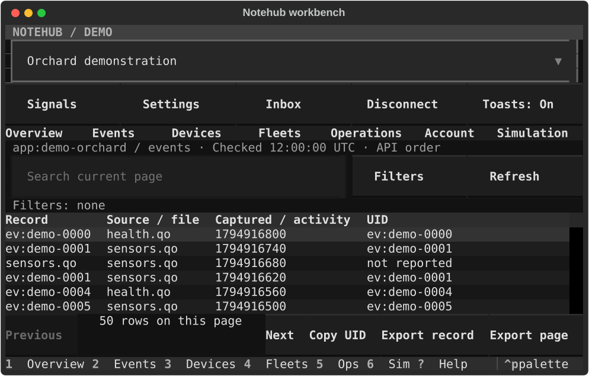
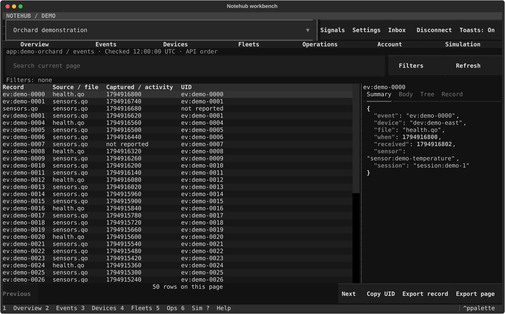

# Terminal workbench

The optional Textual workbench gives developers a keyboard-first way to explore Notehub projects,
devices, fleets, events, operations, and account details. Read views use the public client facades;
the UI stays responsive while reads are in flight and keeps selection and scope when navigating.

Install the `tui` extra to use the real Notehub session, or launch `notehub-client-tui --demo` for a
credential-free tour with deterministic synthetic data. The project picker also offers packaged
Simulation scenarios as local projects. Use the **Simulation Lab** to advance scenario time, step
device behavior, sync queued Notes, and reset a run; Events, Devices, and Fleets then inspect the
same active simulation. No simulation request is sent to Notehub.

## Demo captures

These illustrations come from Textual's headless test driver using the fixed Demo dataset. They
show the compact and wide Events layouts and contain no live account data.





Regenerate them with:

```console
uv run --group test python docs/assets/scripts/export_tui_previews.py
```

## Interaction and visual regression checks

Textual `App.run_test()` and Pilot exercise keyboard, mouse, navigation, refresh, selection, error
recovery, and resizing without a real terminal or Notehub API. The integrated acceptance tests cover
80×24, 100×30, and 140×42 layouts. The official
[`pytest-textual-snapshot`](https://github.com/Textualize/pytest-textual-snapshot) plugin pins SVG
output for the Events view at 80×24 and 140×42; those baselines live beside the TUI tests. See
[Textual's testing guide](https://textual.textualize.io/guide/testing/) for Pilot and snapshot details.

Run the workbench and dispatcher checks with:

```console
uv run --group test pytest tests/unit/runtimes/tui tests/unit/runtimes/test_dispatch.py --no-cov -q
```

When a screenshot test fails, inspect `../temp/snapshot_report.html` before approving a new baseline. Update
only the selected screenshots after reviewing the report:

```console
uv run --group test pytest tests/unit/runtimes/tui/test_visual_snapshots.py --no-cov -q --snapshot-update
```

These checks make UI changes reviewable in CI, but they do not emulate a specific terminal's font
metrics, clipboard integration, color handling, or alternate-screen restoration. Review those
behaviors separately in a physical Windows Terminal session; headless results cannot establish them.
