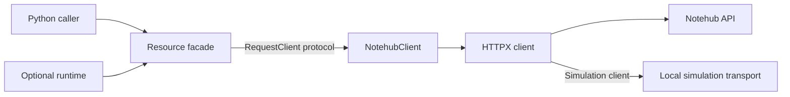

# Python source map

Use this map to decide where to put a change. The package exposes an async
client, resource facades, and optional runtimes that build on those facades.

| Area | Responsibility |
| --- | --- |
| [client.py](notehub_client/client.py) and [helpers](notehub_client/helpers/) | Authentication, HTTP requests, pacing, JSON validation, and transport errors |
| [resources](notehub_client/resources/) | Endpoint paths, query assembly, response envelopes, and traversal |
| [filters](notehub_client/filters/) and [typing](notehub_client/typing/) | Query values, pagination, and the shapes of Notehub responses |
| [compose](notehub_client/compose/) | Convert application objects into outbound identifiers, Note bodies, and environment values |
| [catalog](notehub_client/catalog/) and [payloads.py](notehub_client/payloads.py) | Load portable contracts and opt in to typed decoding of received event bodies |
| [simulate](notehub_client/simulate/) and [hosting](notehub_client/hosting/) | Run local device scenarios and manage application components |
| [runtimes](notehub_client/runtimes/) | CLI, terminal workbench, HTTP API, dashboard, and MCP adapters |

## Follow a request

For example, `client.events.iter_pages()` assembles the query and follows cursors
in the events facade. `NotehubClient.request()` authenticates, sends the request,
and validates the JSON value. The facade checks the event envelope before
yielding a page. Applications can explicitly apply a payload decoder when they
need a domain type.

## Ownership and testing

- A `NotehubClient` closes the HTTP client it creates. Callers close an injected
  HTTP client and any token provider they supply.
- One `RequestPacer` can be shared by clients on the same billing account. It
  reserves a slot before dynamic authentication, and a reservation counts if
  token resolution fails. An HTTP 429 can defer subsequent attempts.
- A simulation run owns its local state. Clients opened on that run share it.
  A hosted component owns the iterator and tasks for its run and borrows the
  client supplied to its host.
- When changing a wire request, test its path, query, and response envelope
  through the facade. Use the simulator for workflows that depend on device
  queues, synchronization, or elapsed scenario time.

See the [contributor guide](../CONTRIBUTING.md) for setup and verification
commands and the [test guide](../tests/README.md) for test layout.

Project, fleet, and device inventory reads require nonempty string UIDs for
follow-up requests. Other record fields retain their endpoint-specific shapes.

Event projections can omit the event UID. Device session records may omit fields
that have no value. Session responses can include `next_cursor` for cursor reads.

`client.devices.iter_session_pages()` uses the same continuation checks as
`client.events.iter_pages()` and yields whole pages for checkpointing.

Fleet detail pages use numbered device navigation and bounded event cursor
history. Event histories are scoped by project, fleet, and immutable query;
refresh validates its replacement before discarding the last successful pages.
